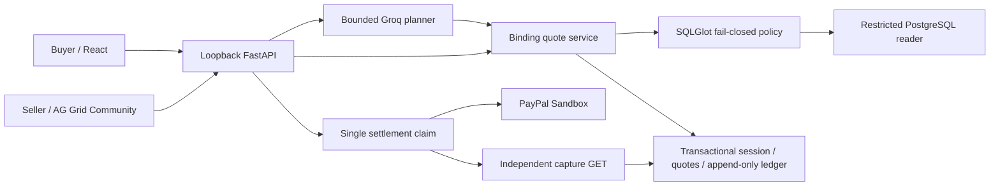

# QueryVault architecture

The model receives only schema and objective; it cannot reserve money or call the
payment API. It can propose three plans. Backend validation and pricing run for
every proposal. Unaffordable plans get feedback without executing. Reported scope
changes stop for human review. A model's scope declaration is not a formal
semantic-equivalence proof; live objective fidelity still needs evaluation.

## SQL boundary

Only enumerated AST constructs/functions are supported. Exactly one top-level
SELECT is required. SQLGlot qualification resolves physical table names, CTEs,
derived tables, aliases, stars and column ambiguity against an explicit schema.
UNION and recursive CTEs are intentionally unsupported. Unknown syntax fails
closed. Input, AST, nesting, join, offset and outer result limits bound complexity.
EXPLAIN omits ANALYZE and uses the same reader limits as execution.

The reader has SELECT on only vault_data tables, no schema-creation or application
table privileges, read-only transactions, a 2s statement timeout, 250ms lock
timeout and explicit search path. PostgreSQL catalogs retain normal built-in
visibility; the application firewall refuses catalog queries. It does not claim
catalogs can be made entirely inaccessible. Authentication, SQL policy and grants
are separate controls. Direct database credentials never reach the browser.

## Financial transitions

created → awaiting_approval → authorizing → authorized → active → settling →
settled / voided. Ambiguous mutations, pending payments and mismatches enter
reconciliation_required. No automatic second payment is created.

Every reservation locks the session row before the quote row. A database CHECK
also enforces `spent + reserved <= budget`. Quote identity binds owner, normalized
SQL hash, dataset-policy version, price version and expiry. Clients submit only
quote IDs to execute. Reservations commit before query execution; success moves
the fixed price to spent, and failure/empty output releases it. Reusing a
completed quote returns its saved result and does not charge again.

Settlement closes the session to new reservations. If reservations remain it
returns a waiting state; call settle after they finish. Once clear, it checks the
charged ledger sum and commits one settlement claim before calling PayPal.
Concurrent callers see the claim. It captures exactly the accumulated cents with
final_capture=true, or voids at zero. A separate GET verifies amount/status.
Reconcile performs reads only and can resolve a known pending capture or void.
Unknown mutations require operator investigation with saved request IDs.

## Explicit limits and risk

- This is a local single-operator prototype, not an authenticated multi-tenant
  deployment. Loopback binding, Host checks, same-origin writes and an HttpOnly
  local cookie protect the development surface; no public deployment is authorized.
- Results are delivered before capture. The merchant bears up to $20 of accrued
  unpaid usage per session if capture fails. An authorization is neither payment
  nor escrow. New execution stops after a one-hour session window.
- Process death between reservation and completion can strand a reservation.
  The design fails closed; fenced query recovery is available as a local UI/API action. There is no background recovery worker, webhook consumer, or transactional remote-payment commit.
- Query-result emptiness determines billing. An aggregate returning a row with
  zero is still a nonempty result and is billable.
- Fixed tiers classify PostgreSQL estimated cost: <=50 → 35 cents, <=200 → 70,
  <=10000 → 140; above 10000 is rejected. These are published prices, not a
  conversion from planner units into dollars. AI-provider token costs are separate.
- Quote TTL is five minutes, maximum output 100 rows. This small synthetic dataset
  does not demonstrate production throughput or exhaustively prove SQL security.

## Follow-on hardening

Quotes are HMAC-bound to session/owner, SQL hash, fixed price, policy/price version and UTC expiry. Explicit client ceilings/hashes are checked before reservation, and execution revalidates the SQL policy. Reader validation and planner cost limits are applied again inside the restricted read-only connection. Reader database TEMP is revoked and temporary spill files are capped.

Durable agent_runs retain objective, bounded decision output and provider/execution failure state. Optimization candidates with different filters/grouping/sources/joins stop for review even when the model says scope_changed=false. This conservative structural check is not a natural-language equivalence proof.

Stale query recovery uses the same session-first lock order. After 30 seconds it marks running quotes failed and releases their holds, with append-only audit entries. Finalization/failure paths check quote state before changing money: a fenced late worker cannot deliver a result, charge, or double-release. No SQL/payment retry occurs. It is a local operator action; no background sweeper is claimed.
