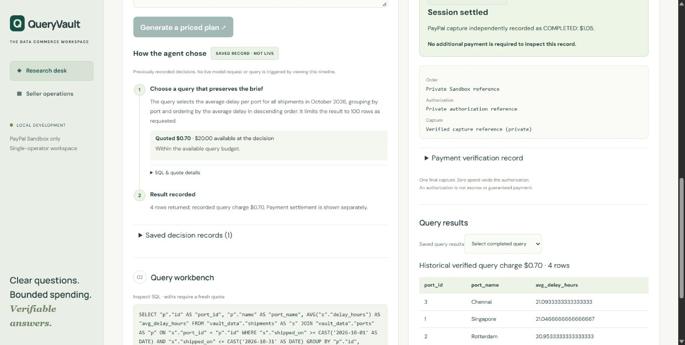

# QueryVault

**The secure, cost-aware agentic data broker.**

An AI research agent should be able to buy a useful answer without receiving unrestricted SQL access or unrestricted spending authority. QueryVault separates those powers: the model proposes, a deterministic gateway validates and prices, PostgreSQL reserves the budget atomically, and PayPal Sandbox settles the session once.

The demonstration asks a supply-chain question: **Which ports had the greatest average shipment delay during October 2026?** It uses 600 explicitly synthetic shipments, four ports and three routes. Nothing is presented as live enterprise data.



## Judge quick start — no private API keys required

Tested prerequisites: **Python 3.13, Node.js 22, PostgreSQL 18 server tools**. Run as a normal user. PostgreSQL must already be installed; PG_BIN can point to its bin directory if auto-detection cannot find it.

```powershell
python bootstrap.py
.\start.ps1
```

On Windows, `start.ps1` launches the local server independently of the PowerShell terminal with an empty stdin, waits for `/health`, and keeps it bound to `127.0.0.1:8000`. Stop it gracefully with `.\stop.ps1`; server output is kept under `.local\queryvault-server.*.log`. If an older foreground server already owns the port, stop it with Ctrl+C in its original PowerShell window, then rerun `.\start.ps1`.

On other platforms, bootstrap.py selects the platform's executable names, then start with:

```sh
.venv/bin/python -m uvicorn app:app --host 127.0.0.1 --port 8000
```

The native bootstrap was previously verified on Windows. The latest clean-source reproduction used Docker/Linux. Open the workspace at [localhost](http://127.0.0.1:8000) or the [local API documentation](http://127.0.0.1:8000/docs). FastAPI serves the production React build from the same origin.

Bootstrap creates a private loopback PostgreSQL cluster, generates local credentials, applies migrations and loads the synthetic dataset. Start from a fresh source directory for a judge walkthrough. The native Windows audit rerun was blocked by package-index DNS and PostgreSQL initialization. Docker/Linux installed both dependency sets from the clean source, built the frontend, and served the Option B preview against a fresh synthetic database without provider credentials.

Use **Inspect historical agent analysis** to examine clearly labeled, previously verified Sandbox evidence. Use **Free synthetic preview** to execute fresh read-only analytics without a financial session or query charge. **Load security test**, then preview, demonstrates rejection. No-credential mode is functional and clearly labeled; it does not pretend to perform live inference or payment.

### Optional Phase B interactive judge mode

The separate `public_interactive` mode adds a natural-language proposal, firewall result, deterministic quote, explicit virtual-allowance acceptance and an actual read-only result against a dedicated synthetic database. It is disabled by default, has no PayPal or financial-ledger authority, and does not replace `public_demo`. Review [OPTION-B-READINESS.md](OPTION-B-READINESS.md) for API boundaries, quotas, kill switch, configuration and deployment limitations. This workspace has not been deployed.

## What was actually verified

| Verification | Actual evidence |
|---|---|
| PayPal Sandbox budget | USD 20.00 authorized |
| Two billable queries | USD 0.70 + USD 0.35 |
| One final capture | USD 1.05, independently retrieved COMPLETED, final_capture=true |
| Financial reconciliation | Zero-cent difference; zero outstanding reservations |
| Separate unused authorization | USD 20.00 independently verified VOIDED, zero capture |
| Backend regression suite | 213 tests and 26 subtests passed from the release candidate against isolated PostgreSQL 18 in Docker/Linux. |
| Frontend | 38 tests passed in the final audit; TypeScript and the production build passed. |
| SQL firewall | The final audit executed 24/24 legitimate cases and rejected 26/26 adversarial cases before execution. The holdout executed 5/5 legitimate cases and rejected 5/5 adversarial cases. |
| Known SQL answers | 20/20 independently calculated answers matched on isolated PostgreSQL in the final audit. |
| Real Groq baseline | 3/3 known answers, reported separately |
| Additional held-out real AI | 12 correct / 12 attempted; 0 incorrect, 0 model failures, 0 policy rejections, 0 scope-change stops |
| Clean-source build | A Docker build without cached layers installed Python and Node dependencies and built the production frontend. The resulting image passed Option B HTTP readiness and returned 600 shipments at zero charge with AI disabled. |
| B2 production-entrypoint integration | 13/13 checks with one saved real Groq request; a separate AI-disabled run passed 10/10 |
| B2 browser fallback | Fresh read-only query returned 600; AI and PayPal counters remained zero |

These are finite synthetic tests, not a general model-accuracy or exhaustive-security guarantee. The existing security corpus contains **50 main cases plus 10 independent holdouts**, rather than a fabricated 40-case result. Automated payment tests use mocks; the historical Sandbox records and real Groq evaluations are identified separately in the reports. Public evidence removes transaction/account identifiers. Raw operator records are excluded from the public package.

## Why the engineering matters

- **SQL authorization:** SQLGlot scopes resolve physical tables, CTEs, subqueries and columns. Unknown constructs, DDL/DML, writable CTEs, set operations, catalog references and non-allowlisted functions fail closed. Database execution independently revalidates the SQL.
- **Database boundary:** a distinct PostgreSQL reader has restricted grants, read-only transactions, explicit search path, a 2-second statement timeout, 250ms lock timeout, no database TEMP permission and a 16MB temporary-file cap. SQLGlot is not the final boundary.
- **Binding prices:** HMAC-bound quotes fix owner, session, SQL hash, price, policy/version and UTC expiry. Explicit accepted ceilings and hashes are checked before reservation. Planner cost selects a published fixed tier; it is not dollars or an execution guarantee.
- **Concurrency:** session-first row locks and a database CHECK enforce spent + reserved <= budget. Repeated quote execution returns the stored result and does not charge twice. New admission stops during settlement.
- **Settlement:** one durable claim precedes the provider call. Independent GET verifies amount/status against the ledger. Unknown, pending or mismatched outcomes fail closed; no automatic second payment is created.
- **Recovery:** stale query reservations can be fenced after 30 seconds; late workers cannot deliver, charge or double-release. This explicit recovery never retries SQL or payments.
- **Agent boundaries:** at most three proposals. The backend owns validation, quote pricing, money and execution. Structural output/filter/group/source/join/order/limit changes during optimization require review even if the model claims unchanged scope. This conservative guard is not a semantic proof.

Prices: estimated planning cost <=50 → 35 cents; <=200 → 70 cents; <=10000 → 140 cents; higher cost is rejected. Quote TTL: five minutes. Maximum output: 100 rows. Query admission ends one hour after authorization. Successful nonempty rowsets are billable; aggregate rows containing zero are nonempty. AI-provider token costs are separate.

## Buyer and seller workflow

The buyer workspace exposes research objectives, SQL inspection, accepted prices, results, stored agent decisions and settlement state. The seller workspace provides the dataset policy, AG Grid search/filtering, quote-versus-charge reconciliation and verified collection totals. Historical records remain viewable after reload.

Seller operations remain available in the application. Seller screenshots are kept local because they display internal ledger row and quote identifiers.

The normal live Sandbox path is create → human approval → independent approval verification → authorize → quote/reserve/execute queries → close session → one final capture. Zero spend voids the authorization. PAY_NOW checkout fields retain intent AUTHORIZE and return to the local confirmation page. Redirect parameters never prove approval; that page performs authenticated, owner-bound PayPal lookups and no payment mutations.

## Configuration and external services

Bootstrap writes ignored .env. Preserve its generated local database settings. Optional private keys are PAYPAL_CLIENT_ID, PAYPAL_SECRET and GROQ_API_KEY. PAYPAL_ENVIRONMENT must be sandbox; live PayPal use is rejected. GROQ_MODEL defaults to openai/gpt-oss-20b because the tested account did not expose Llama 3.3. Model access varies by account.

Do not paste keys into source, chat or public reports. Existing environment variables take precedence. Credentials and raw evidence stay in .env/.local. Historical one-off payment runners are disabled in public source to prevent replay; the normal client and explicitly operated workspace remain intact. No new transaction is needed for the judge walkthrough.

## Deployment preparation — no hosting performed

A portable Dockerfile, Compose configuration, separate repeatable migration job, secret-file support and explicit public-mode production entrypoint are prepared. The optional `public_interactive` overlay selects a separate synthetic database and durable quota volume, with its AI feature disabled by default. The full local workflow remains loopback-only. `public_demo` exposes only named synthetic read-only examples and sanitized historical evidence; its backend denies operator sessions, arbitrary SQL, PayPal and live AI, even if a visitor supplies a local key/cookie. Do not copy the operator .env or database into either public mode.

The November 12 Linux Docker rehearsal built and ran the B2 image, migrated an isolated synthetic database, exercised the guest workflow in a browser, and checked restart, backup and restore, and graceful shutdown. It used a deterministic planner mock. The final audit separately built the sanitized source and verified the AI-disabled workflow over HTTP. See [DEPLOYMENT-READINESS.md](DEPLOYMENT-READINESS.md), [DEPLOYMENT-GATE-REPORT.md](DEPLOYMENT-GATE-REPORT.md), and [OPTION-B-READINESS.md](OPTION-B-READINESS.md) for setup and boundaries.

## Tests and reproduction

```powershell
.\.venv\Scripts\python -m pytest -q
.\.venv\Scripts\python evaluate.py
.\.venv\Scripts\python verify_http.py
.\.venv\Scripts\python -m pip check
npm.cmd --prefix frontend test
npm.cmd --prefix frontend run build
```

`verify_http.py` needs the app running. `reproduce.py` copies the reviewed source files into a fresh directory, creates a separate virtual environment and PostgreSQL cluster on port 55433, runs both suites, then stops its test services. This path requires package-registry access and PostgreSQL server tools. `evaluate.py` saves a new report under `.local/evaluations/` by default. Optional live Groq evaluation uses provider quota and requires the judge's own key.

## API and design references

API schemas are in openapi.json and /docs. Core local routes: POST /sessions, /quote, /execute, /agent; GET /sessions/{id}, /queries, /agent-runs and /ledger; POST /sessions/{id}/settle, /reconcile and /recover-queries. Free preview is POST /demo/query; sanitized historical evidence is GET /demo/evidence. The separate B2 routes are GET /interactive/state and /interactive/plans/{plan_id}, and POST /interactive/plan, /accept and /execute. They are mounted only in `public_interactive` and never expose payment authority. GET /health reports mode-specific capability and database reachability.

See [DEPLOYMENT-READINESS.md](DEPLOYMENT-READINESS.md), [DEPLOYMENT-GATE-REPORT.md](DEPLOYMENT-GATE-REPORT.md), and [OPTION-B-FINAL-VERIFICATION.md](OPTION-B-FINAL-VERIFICATION.md) for the latest engineering status. Additional references: [ARCHITECTURE.md](ARCHITECTURE.md), [SECURITY.md](SECURITY.md), [POSITIONING.md](POSITIONING.md), [QA-REPORT.md](QA-REPORT.md), [LICENSE](LICENSE), and [THIRD_PARTY.md](THIRD_PARTY.md). This project complements payment and agent-payment infrastructure by implementing a concrete SQL-data-commerce enforcement layer; it does not claim to invent payment protocols or replace existing rails.

## Limits and submission status

Local single-operator prototype; not a production multi-tenant service. Authorizations are not escrow or guaranteed payment. Delivering results before final capture exposes the merchant to up to USD 20 unpaid usage per session. Unknown remote outcomes still require operator reconciliation. No webhook consumer/background sweeper, load-test claim or formal NL-equivalence proof is included.

The final audit build emitted the existing 1.12 MB lazy seller-ledger chunk warning. The app entry bundle was 284 KB. The backend test client emitted a Starlette/httpx deprecation warning. The source includes three buyer screenshots. Seller screenshots display internal ledger and quote identifiers and remain private.

## Final buyer presentation

Agent decisions are shown as a readable timeline: preserved research brief, quoted fee versus the recorded available budget, and a result only when a stored result exists. SQL and quote fields remain in expandable technical details. Saved evidence is labeled NOT LIVE, new Sandbox checkout is a collapsed separate operation, and completed sessions show a settled/voided record rather than another settlement button.

“Unspent session budget” is an internal accounting calculation. It does not independently verify PayPal hold release, a refund or funding-source availability. See [FINAL-DEMO.md](FINAL-DEMO.md) for the exact no-new-payment 2:40 shot list.

## Constrained-budget economic demonstration

A real non-billing run now tests the existing agent with a 50-cent evaluation allowance. It received two real 70-cent quotes (planner cost 64.4) for the same normalized full-month port-delay query and refused after three model responses. It did **not** produce a distinct cheaper rewrite or demonstrate successful optimization. That limitation is explicit; the model's impossibility assertion is not treated as proof. The agent now records all attempts and allows one bounded reconsideration/requote when an over-budget response proposes no SQL, without bypassing scope checks or prescribing a successful answer.

Run `demo_economics.py --budget-cents 50` only for a new real Groq/PostgreSQL evaluation; it consumes provider quota. The evaluation broker reuses real validation, EXPLAIN and production pricing but creates no financial session, payment or billable query. Model outcomes can vary. The recorded result is summarized in ECONOMIC-DEMO.md; its raw report is local and excluded from the public package. The final storyboard is 2:40 and includes a separate fresh successful free SQL query returning 600 October shipments; that count is not portrayed as an optimized answer to the port-delay question.
